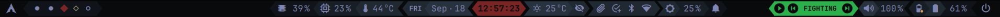

# HYPRBAR

A simple QuickShell (QML) status bar for Hyprland.



I built it for personal use on my side-project laptop, which has two batteries and a single screen. I didn't bother adding multi-monitor support, nor a configuration
option for single-battery laptops. Everything else — glyphs, fonts, colours, module spacing, and settings such as the vitals polling interval — is configurable.

## Modules

Most modules respond to the mouse: scroll to change volume and brightness, left-click to mute, right-click to switch the volume module between output and input, and click the vitals, weather and date segments to open a floating terminal popup.

Hyprbar also displays notification toasts, so another notification daemon such as
SwayNC must not run alongside it. The center can be toggled from a key binding with
`qs ipc -c hyprbar call notifications toggle`. History and do not disturb survive
hot reloads within the running session; they are not saved across restarts. History
limits, toast timeouts, silent applications, and popup styling are configured in
`Settings.qml`. Popup QML lives in `popups/`; manager dimensions and spacing are in
`widgets/notificationmanager/Configuration.qml`.

The power button opens a native power-menu with Lock, Suspend, Reboot, Power Off, and
Log Out. It can also be
toggled with `qs ipc -c hyprbar call powermenu toggle`.

Volume and display-brightness keys also show a temporary slider menu on the left.
Use `qs ipc -c hyprbar call slidermenu open volume` (or `brightness`) to preview it.

Right-click the clock to open the centered theme panel, or run
`qs ipc -c hyprbar call thememanager toggle`. Escape or a click outside closes it.
The panel opens on the applied source. Its Oxidye/Matugen buttons navigate between
pages without applying anything; the body and window height slide together.
The Matugen page is empty for now. Select an image theme externally with Oxidye.

`MODE:` beside the page buttons names the applied source. The LIGHT/DARK switch,
whose middle chevron shows the active mode, switches the applied source's mode immediately.
Brightness right-click performs the same action, including while the panel is
closed. A pending accent draft is never included in a mode toggle.

On the Oxidye page, drag the hue, saturation and value (HSV) sliders to preview
locally. The **APPLY** chevron above them, led by a colour sample, converts the
colour to an opaque OKLCH seed and applies it through Oxidye's fixed workflow. It can also
return from an active Matugen theme to fixed mode. An untouched seed is applied
unchanged, even one outside sRGB; the sliders then show its displayed colour.
Greys keep their hue as seed metadata, so raising saturation restores it.
Hyprbar's fixed-mode accent is the seed's sRGB display colour, so very dark or
pale picks can be hard to read in the bar, while application fills use Oxidye's
independently derived, contrast-checked tones.

Saved-colour hexagons restore full OKLCH seeds for editing; right-click one to
remove it. The **+** saves the current spectrum without applying it. When the row
overflows, the mouse wheel scrolls it. Optional built-in seeds go in the widget
configuration's `savedSpectra` array and cannot be removed; UI saves retain the existing
`Quickshell.statePath("theme-spectra.json")` file under hyprbar's XDG state directory.

Drafts survive page and appearance changes. Closing discards unapplied edits;
externally changed fixed seeds reset the draft. Accepted operations finish after
the panel closes. Errors are retained for the next opening. The width, executable
path and icons live in `widgets/thememanager/Configuration.qml`.

Use `qs ipc -c hyprbar call applicationlauncher toggle` to
toggle it. Type to filter applications, use Up/Down to select, Enter to launch, and
Escape to close. Prefix the search with `>` to list commands from
`widgets/applicationlauncher/LauncherActions.qml`; matching actions appear before
the entry that runs your typed shell command. Appearance and layout live in
`widgets/applicationlauncher/Configurations.qml`.

## Dependencies

### System services

These back the individual modules. Most are already present on a typical Hyprland
desktop, but the matching module will sit empty if one is missing.

| Package | Used for |
| --- | --- |
| `pipewire`, `wireplumber` | volume and mute state |
| `pavucontrol` | settings for the volume widget |
| `libpulse` | `pactl`, used to detect the analog headphone jack (see notes) |
| `upower` | battery levels and charge state |
| `accountsservice` | user profile icon from AccountsService configuration |
| `networkmanager` | Wi-Fi status |
| `bluez`, `bluez-utils` | Bluetooth status |
| `brightnessctl` | setting the backlight |
| `hyprsunset` | scheduled night light and the brightness popup switch |
| `ddcutil` | external monitor brightness through DDC/CI (optional) |

### Required

| Package | Used for |
| --- | --- |
| `quickshell` | the shell itself |
| `oxidye` | fixed/image theme state and theme-manager actions; install separately |
| `hyprland` | compositor, workspace state |
| `ttf-jetbrains-mono` | label font |
| `ttf-iosevkaterm-nerd` | icon font (Nerd Font glyphs) |

```sh
sudo pacman -S quickshell hyprland ttf-jetbrains-mono ttf-iosevkaterm-nerd
```

### Optional

These support optional click actions and modules. Install only the parts you use.

| Package | Used for |
| --- | --- |
| `hyprlock` | locking the session from the power menu |
| `kitty` | floating terminal popups |
| `clipse` (AUR) | clipboard manager |
| `btop` | vitals popup |
| `curl` | weather popup (`wttr.in`) |
| `util-linux` | `cal`, calendar popup |
| `libnotify` | `notify-send` |
| `network-manager-applet` | `nm-connection-editor` |
| `blueman` | `blueman-manager` |
| `pacman-contrib` | `checkupdates`, for the update script |
| `spotify-bin` | Spotify desktop player for the Spotify module |
| `gtk3` | `gtk-launch`, used by the Spotify module |
| `cava` | audio spectrum around the MPRIS player's album art |
| `intel-gpu-tools` | Intel i915 GPU utilization in VitalsViewer |

Intel GPU utilization uses `intel_gpu_top` while VitalsViewer is open, at
`Settings.systemStatsPollingIntervalMs`. Grant its performance-counter capability
once after installing `intel-gpu-tools`:

```sh
sudo setcap cap_perfmon=ep /usr/bin/intel_gpu_top
```

Package upgrades can remove this capability; reapply it if the iGPU reading shows
`—`. Only `intel_gpu_top` needs this capability, not Quickshell.

## Installation

### 1. Clone

QuickShell looks for configurations under `~/.config/quickshell/`, and the directory
name is what you pass to `qs -c`. Clone it as `hyprbar`:

```sh
git clone https://github.com/diogofd8/hyprbar.git ~/.config/quickshell/hyprbar
```

### 2. Try it

With Hyprland already running:

```sh
qs -c hyprbar
```

Errors and warnings are printed to the terminal, which is the quickest way to find a
missing font or dependency. The bar hot-reloads when you save a file, so you can leave
this running while you tweak things.

### 3. Autostart with Hyprland

**If you use the Lua configuration** (`~/.config/hypr/hyprland.lua`), add it to your
start handler:

```lua
hl.on("hyprland.start", function()
    hl.exec_cmd("qs -c hyprbar")
    -- ... your other autostart commands
end)
```

Add these layer rules to the same file for blur and power-menu stacking:

```lua
-- Background opacity is composed by QML; Hyprland blurs the painted surfaces.
hl.layer_rule({
    name = "hyprbar-blur",
    match = { namespace = "hyprbar" },
    blur = true, ignore_alpha = 0.01, no_anim = true
})
hl.layer_rule({
    name = "hyprbar-slidermenu-blur",
    match = { namespace = "hyprbar-slidermenu" },
    blur = true, ignore_alpha = 0.01, no_anim = true
})
-- Keep the unblurred desktop dimmer above other overlays and below the menu.
hl.layer_rule({
    name = "hyprbar-powermenu-dimmer",
    match = { namespace = "hyprbar-powermenu-dimmer" },
    blur = false, order = -1, no_anim = true
})
hl.layer_rule({
    name = "hyprbar-powermenu-blur",
    match = { namespace = "hyprbar-powermenu" },
    blur = true, ignore_alpha = 0.01, order = -2, no_anim = true
})
-- The shared popout host also owns native tray menus.
hl.layer_rule({
    name = "hyprbar-popout",
    match = { namespace = "hyprbar-popout" },
    blur = true, blur_popups = true, ignore_alpha = 0.01, no_anim = true
})
hl.layer_rule({
    name = "hyprbar-notifications",
    match = { namespace = "hyprbar-notifications" },
    blur = true, blur_popups = true, ignore_alpha = 0.01, no_anim = true
})
hl.layer_rule({
    name = "hyprbar-applicationlauncher",
    match = { namespace = "hyprbar-applicationlauncher" },
    blur = true, blur_popups = true, ignore_alpha = 0.01, no_anim = true
})
hl.layer_rule({
    name = "hyprbar-thememanager",
    match = { namespace = "hyprbar-thememanager" },
    blur = true, ignore_alpha = 0.01, no_anim = true
})
```

### 4. Floating popups

The vitals, weather and calendar actions open Kitty windows with specific titles.
They only float if you have rules for them:

```lua
hl.window_rule({
    name = "hyprbar-vitals",
    match = { class = "kitty", title = "^(waybar-vitals)$" },
    float = true, move = "150 35", size = "800 600",
})
```

```ini
windowrule = float, class:kitty, title:^(waybar-vitals)$
windowrule = move 150 35, class:kitty, title:^(waybar-vitals)$
windowrule = size 800 600, class:kitty, title:^(waybar-vitals)$
```

## Configuration

Global configuration lives in three files at the repository root:

- **`Settings.qml`** — glyphs, fonts and sizes, bar dimensions and padding, module spacing, polling intervals, scroll step sizes, and the threshold tables that map a value onto a state (`cpuStressThresholds`, `batteryLevelThresholds`,
  `volumeLevelThresholds`, `brightnessLevelThresholds`, …).
- **`Theme.qml`** — standalone light/dark palettes and active system-palette mappings.
- **`WeatherConfig.qml`** — location and units. **Change this before first run**; it
  ships with my coordinates (Porto, PT).

Each widget also has a singleton `Configuration.qml` under `widgets/<widget>/`
for adjusting its icons, sizes and spacing. The application launcher uses
`widgets/applicationlauncher/Configurations.qml`. Shared widget settings live in
`widgets/WidgetConfiguration.qml`.

Threshold tables and icon arrays are indexed together, so if you add a state you must add the icon that goes with it.

`Settings.colors` provides the selected theme's background and foreground roles. `Settings.fixedColors` references `Theme.fixed` for Spotify and the two battery marker colours, shared by every theme.

### Active system palette

Oxidye owns generation, installation and application reloads. Hyprbar only reads
its committed state and invokes the installed command for explicit actions. It
runs no startup command, wallpaper query, polling loop or resident theme helper.

Install Oxidye and its toolkit dependencies first. Its command defaults to
`~/.local/bin/oxidye`; change `oxidyeExecutable` in the theme-manager configuration
for another installation. Matugen is Oxidye's optional image-generation dependency;
switching an already-rendered image theme requires neither Matugen nor its image.

Hyprbar watches `${XDG_CONFIG_HOME:-$HOME/.config}/oxidye/applied.json` for the
confirmed `mode`, `source` (`fixed` or `matugen`) and opaque OKLCH `seed`.
The configured accent file in `oxidye/config.json` supplies the separate stored
fixed seed. An applied fixed seed takes precedence over that source file until
Oxidye commits a new application.

With `source: fixed`, `Settings.colors` selects `Theme.dark` or `Theme.light`.
Hyprbar retains its authored backgrounds, text, semantic colours and opacities.
Both appearances use the confirmed seed's display colour as their accent.
Out-of-gamut chroma reduction affects only the local display copy, not the submitted
seed. Without valid applied state, the original standalone colours remain available.

With `source: matugen`, `Settings.colors` selects `Theme.matugen`. The reader loads
`oxidye/matugen/gtk/applied.json`, checks that its mode and seed match the commit
marker, and publishes the required RGB/alpha roles together:

| Hyprbar role | Oxidye Matugen role |
| --- | --- |
| `background.highlight`, `background.imagePlaceholder` | `scrollbar` |
| `background.main`, `foreground.contrast` | `window_bg` |
| `background.tint1` | `surface_low` |
| `background.tint2` | `surface` |
| `background.tint3` | `surface_high` |
| `background.tint4` | `surface_highest` |
| `foreground.main` | `scrollbar` |
| `background.accent`, `foreground.accent` | `accent_bg` |

Error, alert, charging, battery and Spotify colours retain their definitions in
`Theme.qml`. The matching standalone palette supplies opacity values; border and
muted colours are derived from the active colours. Missing or malformed updates
preserve the last complete valid palette. Hyprbar never writes Oxidye's state.

Equivalent external commands:

```sh
oxidye theme --mode light --format json
oxidye theme --accent 'oklch(0.397103719 0.120772653 260)' --format json
oxidye matugen --image "$HOME/Pictures/wallpaper.jpg" --mode dark --format json
oxidye matugen --mode light --format json
```

`theme` selects the fixed workflow; `matugen` selects the image workflow. Omitting
an option preserves its configured value. Fixed and image-derived selections are
independent. Reopen GTK/Qt applications for complete styling and icon updates;
VS Code settings normally update live. The bar never restarts applications.

### Before it works on your machine

- **Battery device names.** `Settings.qml` maps `internalBatteryPath: "BAT0"` and
  `externalBatteryPath: "BAT1"`. Check yours with `ls /sys/class/power_supply/`.
- **Spotify.** The module reads Spotify's MPRIS state and scrolls metadata in QML.
  Edit `SpotifyConfig.qml` to change the player, text format, and scroll behavior.
- **Audio spectrum.** CAVA captures the default PipeWire output mix while the system
  page is visible and the selected MPRIS player is playing. Bar dimensions and frame
  rate live in `widgets/centerpiece/Configuration.qml`; set
  `mprisVisualizerBarCount` to `0` to disable capture. Hyprbar supplies its own CAVA
  configuration without changing `~/.config/cava/config`.

## Notes and limitations

- **Single monitor.** The bar is created once, not per screen.
- **Two batteries.** The battery module shows one icon per pack with a coloured dot
  marking whichever is currently charging or discharging, and a single percentage for
  the active one. On a single-battery laptop the second icon will show as absent.
- **Workspace clicks need the Lua config.** `Actions.focusWorkspace()` dispatches
  `hl.dsp.focus({ workspace = "N" })`, which only works when Hyprland is running a Lua
  configuration. On a classic `hyprland.conf` setup, change it to
  `Hyprland.dispatch("workspace " + target)`.
- **The headphone jack is detected through `pactl`.** Plugging into the built-in
  3.5 mm jack switches the ALSA *route* without changing any PipeWire node property,
  so there is nothing for QuickShell to observe. `core/Audio.qml` therefore keeps a
  `pactl subscribe` process running and re-reads the active port when it fires
  (debounced, so a volume scroll doesn't spawn a process per tick). Bluetooth and USB
  headsets are detected from node properties and don't need this.
- **Arch Linux.** Package names and the update script assume `pacman`.

## In the future

I plan to add:

- Drop-down menus for vitals (with a `btop`-inspired look), battery (KDE-inspired),
  and volume (with MPRIS), among other nice functionality I might remember in the
  meantime

## License

MIT — see [LICENSE](LICENSE).
